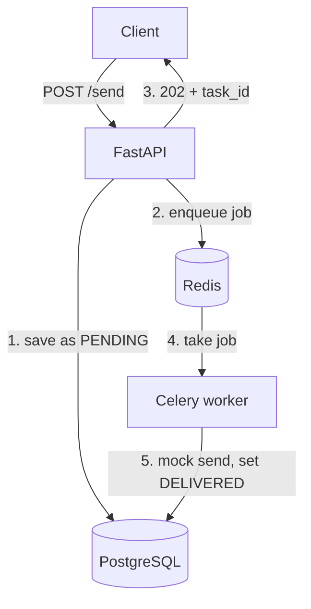

# FastAPI Notification Hub

[](https://github.com/nicolinx/fastapi-notification-hub/actions/workflows/ci.yml)

A small notification service built to learn FastAPI, async Python and background workers. The API accepts a notification, queues it, and answers `202 Accepted` right away. A Celery worker delivers it later and updates its status in PostgreSQL.

> Delivery is mocked. The worker logs a fake email or push message and waits one second. It does not talk to SMTP or FCM.

## How it works



1. The API validates the request and saves the notification as `PENDING`.
2. It pushes a job to Redis and returns `202` with a `task_id`.
3. The worker takes the job, "sends" the message, and sets the status to `DELIVERED`.
4. The client can check the status at any time with the `task_id`.

## Quickstart

You need Docker.

```bash
git clone https://github.com/nicolinx/fastapi-notification-hub.git
cd fastapi-notification-hub
make stack
```

`make stack` builds the image and starts PostgreSQL, Redis, a one-shot migration, the API and the worker.

There is no endpoint to create users yet, so add one by hand:

```bash
docker compose exec postgres psql -U postgres -d notification_hub \
  -c "INSERT INTO users (email, name) VALUES ('test@example.com', 'Test User');"
```

Send a notification:

```bash
curl -X POST localhost:8000/api/v1/notifications/send \
  -H "Content-Type: application/json" \
  -d '{"user_id":1,"channel":"EMAIL","title":"Hello","body":"First message"}'
```

The response comes back immediately:

```json
{
  "task_id": "b6bcba23-6345-47ef-92c0-ad4e759095e0",
  "status": "PENDING",
  "channel": "EMAIL",
  "title": "Hello",
  "created_at": "2026-11-14T05:40:00Z",
  "updated_at": "2026-11-14T05:40:00Z"
}
```

About a second later, the status is `DELIVERED`:

```bash
curl localhost:8000/api/v1/notifications/<task_id>
```

Interactive docs are at http://localhost:8000/docs. Stop everything with `make down`.

## API

| Method | Path | Description |
|---|---|---|
| `POST` | `/api/v1/notifications/send` | Queue a notification. Returns `202` and a `task_id`. |
| `GET` | `/api/v1/notifications/{task_id}` | Get the delivery status. |
| `GET` | `/health` | Liveness check. |

Errors use one shape: `{"error": {"code": "user_not_found", "message": "..."}}`.

## Development

```bash
uv sync
cp .env.example .env
make up        # PostgreSQL and Redis only
make migrate
make dev       # API with auto-reload
make worker    # worker, in a second terminal
make check     # ruff, mypy and pytest
```

`make worker` runs Celery with `--pool=solo` because the default pool fails on macOS in this setup. The Docker image uses the default pool on Linux.

Tests run against a real PostgreSQL database named `notification_hub_test`, which is created automatically. Only Celery is mocked, so the tests need no Redis. CI runs `make check` on every push and pull request.

## Design decisions

- Queue instead of inline work. Sending is slow, so the API only saves and enqueues. The request stays fast no matter how long delivery takes.
- Commit, then enqueue. The row is committed before the job is sent. If it were the other way round, the worker could look for a row that does not exist yet.
- Tasks are called by name. The API sends `"notifications.dispatch"` and never imports worker code. The two processes only agree on that string.
- Async API, sync worker. FastAPI uses an async SQLAlchemy session. Celery tasks are plain functions, so the worker uses a separate sync session.
- Idempotent task. If a notification is already `DELIVERED`, the task skips it, so a repeated job does not send twice.
- Schemas separate from models. Request and response shapes (Pydantic) are not the database tables (SQLAlchemy), so internal columns do not leak into the API.
- Real database in tests. PostgreSQL enums and constraints behave differently from SQLite, so tests use the real thing.

## Known limitations

- Dual write. If Redis is down right after the database commit, the row stays `PENDING` and no job exists. A transactional outbox or a periodic sweeper would fix this. Neither is built yet.
- No retries or dead-letter queue, no authentication, no rate limiting, no idempotency keys.
- Not benchmarked. There are no throughput or latency numbers yet.
- `docker-compose.yml` contains development credentials. Do not use it as-is in production.

## Tech stack

Python 3.12, FastAPI, Pydantic v2, SQLAlchemy 2.0 (async) with Alembic, PostgreSQL, Redis, Celery, pytest, ruff, mypy, Docker Compose, GitHub Actions. Dependencies are managed with `uv`.

## Roadmap

- Phase 2: idempotency keys, rate limiting, Jinja2 templates, load test with real numbers.
- Phase 3: WebSocket status updates, retries with backoff, Prometheus metrics, a Flutter demo client.
